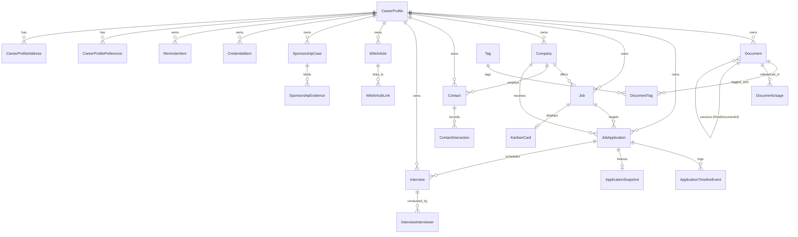

# CareerOS — Database Schema & Data Governance Specification

## 🏛️ Executive Summary & Engine Principles

**CareerOS** employs **SQLite 3** as its sole, local-first relational database engine (`data/careeros.db`). The database is architected for uncompromised local performance, zero telemetry, full offline autonomy, and user data sovereignty.

---

## 1. Data Governance & Schema Evolution Policy

The database architecture strictly enforces the following design rules across all entities and migrations:

| Rule | Specification |
|---|---|
| **No Soft Delete** | Soft deletion patterns are strictly prohibited. Records are never marked with pseudo-flags to hide them from queries. |
| **No Shadow Columns** | Tables, entities, and models must **never** declare `IsDeleted`, `DeletedAt`, `DeletedBy`, or equivalent columns. |
| **User-Confirmed Permanent Deletion** | Any record deletion (jobs, documents, applications, contacts, credentials) is permanent, executing SQL `DELETE`. Every deletion must be explicitly confirmed by the user in the UI. |
| **Zero Automatic Data Deletion** | The database and background services never silently prune, TTL-expire, or automatically delete records. Follow-up reminders and document expiration warnings are non-destructive informational alerts. |
| **Additive Schema Changes** | Schema evolution is strictly additive: `CREATE TABLE IF NOT EXISTS`, `CREATE INDEX IF NOT EXISTS`, and `ALTER TABLE ... ADD COLUMN ...` with nullability or defaults. Destructive table drops or column renames are prohibited. |
| **Preserve Existing Data During Upgrades** | Any application version upgrade must preserve 100% of existing user data in `careeros.db` without corruption, loss, or requiring manual database recreation. |
| **Backward-Compatible Migrations** | All schema migrations are forward- and backward-compatible. Existing `CareerProfiles` and legacy records continue to function without modification. |
| **Historical Immutability via Versioning & Snapshots** | Historical integrity is maintained through explicit first-class domain models: Document Version chains (`Document.Version`, `ChildVersions`, `RootDocumentId`) and submission snapshots (`ApplicationSnapshot`), NOT soft-delete shadow rows. |

---

## 2. High-Throughput SQLite Performance PRAGMAs

On startup, CareerOS issues optimized PRAGMA directives ensuring low-latency concurrency:

```sql
PRAGMA journal_mode = WAL;          -- Non-blocking concurrent readers during write transactions
PRAGMA synchronous = NORMAL;        -- High-speed disk flush balancing integrity and microsecond commits
PRAGMA cache_size = -64000;         -- 64 MB dedicated page cache in RAM
PRAGMA temp_store = MEMORY;         -- In-memory execution of sorts, group-by, and temporary tables
PRAGMA mmap_size = 268435456;       -- 256 MB memory-mapped I/O avoiding buffer copying
PRAGMA foreign_keys = ON;           -- Enforce relational foreign key integrity
```

---

## 3. Entity Relationship Architecture



---

## 4. Complete Table Catalog

### 4.1 Workspace & Personal Dossier
- **`CareerProfiles`**: Multi-person workspace boundary (`Id`, `Name`, `Slug`, `Relationship`, `AvatarColor`, `IsDefault`, `TargetCompensationMin`, `TargetCompensationMax`, `Notes`, `CreatedAt`, `UpdatedAt`).
- **`CareerProfilePreferences`**: Target roles, target industries, preferred remote models, and location preferences per profile.
- **`CareerProfileAddresses`**: Profile-specific residential, permanent, and relocation target addresses.
- **`Profiles`**: Legacy personal dossier details (`FirstName`, `LastName`, `Headline`, `Summary`, `PrimaryEmail`, `Phones`, etc.).
- **`ProfileCitizenships`**: Country citizenship records with passport metadata and primary nationality flag.
- **`WorkAuthorizations`**: Visa and work eligibility records with issue dates, expiry dates, and sponsorship requirement flags.
- **`SocialLinks`**: Centralized web presence footprint (LinkedIn, GitHub, Tech Blogs, Portfolios).
- **`Addresses`**: Physical address locations and relocation preferences.

### 4.2 Documents & Vault (Phase 1 & Phase 3)
- **`Documents`**: Vault files (`FileName`, `OriginalFileName`, `ContentType`, `FileSizeBytes`, `StoragePath`, `Sha256Hash`, `Version`, `IsLatestVersion`, `Category`, `DocumentNumber`, `IssuingAuthority`, `IssueDate`, `ExpiryDate`, `RootDocumentId`, `CountryId`, `RegionId`, `CareerProfileId`).
- **`Tags`**: Universal tagging registry (`Name`, `Color`, `Description`).
- **`DocumentTags`**: Many-to-many junction binding tags to documents.
- **`DocumentUsages`**: Audit trail linking documents to applications, companies, visas, and legal cases.
- **`Countries`**: ISO 3166 country registry (`IsoCode`, `Name`, `CurrencyCode`, `PhoneCode`).
- **`Regions`**: Sub-national administrative regions, provinces, and states linked to countries.

### 4.3 Resume Center (Phase 4)
- **`ResumeProfiles`**: Career archetypes and personas (e.g., Staff Systems Lead, VP of Engineering).
- **`ResumeVersions`**: Tailored resume variants with ATS keywords, change logs, and document references.
- **`CoverLetters`**: Markdown application pitch letters and tailored cover letter templates.
- **`PortfolioVersions`**: Audience-targeted portfolio links and case study configurations.
- **`ResumeSubmissions`**: Log of submissions tracking submission channels (LinkedIn, Referral, Direct).
- **`SubmissionSnapshots`**: Frozen submission records capturing resume state and cover letter text.

### 4.4 Companies, Jobs & Applications (Phases 5, 6, 7 & 12)
- **`Companies`**: Target employers (`Name`, `Description`, `Headquarters`, `Size`, `Industry`, `Stage`, `SponsorshipStatus`, `RelocationPolicy`, `Rating`, `CareerProfileId`).
- **`Jobs`**: Open requisitions (`Title`, `CompanyId`, `Seniority`, `EmploymentType`, `WorkplaceModel`, `MinSalary`, `MaxSalary`, `Currency`, `Status`, `Priority`, `TechStack`, `CareerProfileId`).
- **`JobApplications`**: Application pipeline entries (`JobId`, `CompanyId`, `ResumeVersionId`, `CoverLetterId`, `PortfolioVersionId`, `Status`, `ApplicationDate`, `Channel`, `ReferralContactId`, `SnapshotId`, `CareerProfileId`).
- **`ApplicationTimelineEvents`**: Chronological audit trail of status transitions, notes, and milestones.
- **`ApplicationSnapshots`**: Cryptographically frozen submission record with resume text, SHA-256 hash, and cover letter markdown.
- **`KanbanCards`**: Real-time drag-and-drop board cards (`Column`, `Position`, `JobId`, `ApplicationId`, `Notes`).

### 4.5 Networking & Interviews (Phases 8 & 9)
- **`Contacts`**: Professional network CRM (`Name`, `CompanyId`, `Title`, `Email`, `Phone`, `Category`, `LinkedInUrl`, `RelationshipStrength`, `CareerProfileId`).
- **`ContactInteractions`**: Historical interaction logs (`InteractionType`, `Date`, `Summary`, `FollowUpDate`).
- **`Interviews`**: Interview loops (`ApplicationId`, `JobId`, `RoundNumber`, `RoundType`, `Format`, `ScheduledAt`, `MeetingLink`, `DebriefNotes`, `SelfRating`, `CareerProfileId`).
- **`InterviewInterviewers`**: Panel interviewers linked to contacts or ad-hoc recruiter profiles.

### 4.6 Knowledge Base & Sponsorship (Phases 10 & 11)
- **`WikiArticles`**: Offline Markdown knowledge base (`Title`, `Slug`, `Category`, `Content`, `Tags`, `IsFavorite`, `CareerProfileId`).
- **`WikiArticleLinks`**: Bi-directional backlinks table parsing Obsidian-style `[[slug]]` links.
- **`SponsorshipCases`**: Global visa tracking cases (`CountryId`, `ProgramName`, `ProgramType`, `Eligibility`, `Availability`, `FilingDeadline`, `CareerProfileId`).
- **`SponsorshipEvidences`**: Document binder linking vault documents to sponsorship cases with verification status.

### 4.7 Security & Reminders (Phases 13 & 16)
- **`Credentials`**: Portal credentials (`ServiceName`, `Username`, `EncryptedPassword`, `CompanyId`, `CareerProfileId`).
- **`SecuritySettings`**: Vault salt, PBKDF2 parameters, and timeout preferences.
- **`ReminderItems`**: Proactive notifications (`Type`, `Title`, `Message`, `DueDate`, `IsDismissed`, `IsSnoozed`, `SnoozedUntil`, `DeduplicationKey`, `CareerProfileId`).

### 4.8 Universal Search (Phase 14)
- **`GlobalSearchEntries`**: SQLite **FTS5** virtual table indexing all entities with Unicode61 Porter stemming tokenization and BM25 ranking.

---

## 5. Composite Performance Indexes

```sql
CREATE INDEX IF NOT EXISTS IX_JobApplications_Status_ApplicationDate ON JobApplications (Status, ApplicationDate);
CREATE INDEX IF NOT EXISTS IX_Companies_Industry_SponsorshipStatus ON Companies (Industry, SponsorshipStatus);
CREATE INDEX IF NOT EXISTS IX_Jobs_Status_Priority ON Jobs (Status, Priority);
CREATE INDEX IF NOT EXISTS IX_Contacts_CompanyId_Category ON Contacts (CompanyId, Category);
CREATE INDEX IF NOT EXISTS IX_Interviews_ScheduledAt_Status ON Interviews (ScheduledAt, Status);
CREATE INDEX IF NOT EXISTS IX_Documents_Category_ExpiryDate ON Documents (Category, ExpiryDate);
CREATE INDEX IF NOT EXISTS IX_Credentials_ServiceName ON Credentials (ServiceName);
CREATE INDEX IF NOT EXISTS IX_Credentials_CompanyId ON Credentials (CompanyId);
CREATE INDEX IF NOT EXISTS IX_ReminderItems_DeduplicationKey ON ReminderItems (DeduplicationKey);
CREATE INDEX IF NOT EXISTS IX_ReminderItems_IsDismissed_IsSnoozed ON ReminderItems (IsDismissed, IsSnoozed);
CREATE UNIQUE INDEX IF NOT EXISTS IX_CareerProfiles_Slug ON CareerProfiles (Slug);
```

---

## 6. Schema Migration Guidelines

When introducing new database entities or expanding existing schemas:

1. **Strictly Additive**:
   - Write migrations using `CREATE TABLE IF NOT EXISTS` and `ALTER TABLE ... ADD COLUMN ...`.
   - All newly added columns on existing tables must be nullable or provide a default value so that existing records in `careeros.db` remain valid without manual intervention.

2. **No Column Drops or Table Recreations**:
   - Never run `DROP TABLE` or destructive table alterations that drop existing user data.
   - Maintain backward compatibility so that existing CareerProfiles continue operating seamlessly.

3. **Verification**:
   - Verify migrations using static build validation (`dotnet build CareerOS.sln --no-restore -m:1 /nodeReuse:false`).
   - Validate that clean startups auto-initialize missing tables without altering or resetting existing rows.

---

*CareerOS — 100% Local-First. Sovereign, Offline, and Permanent.*

